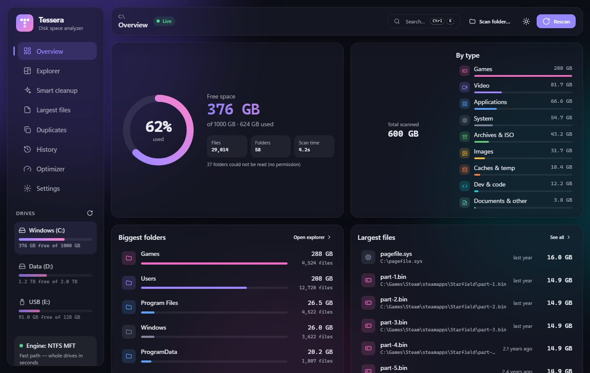
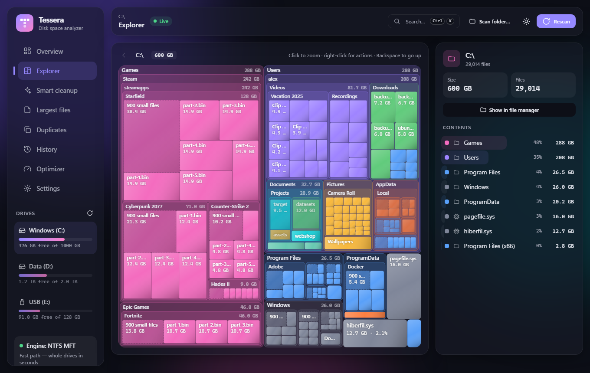
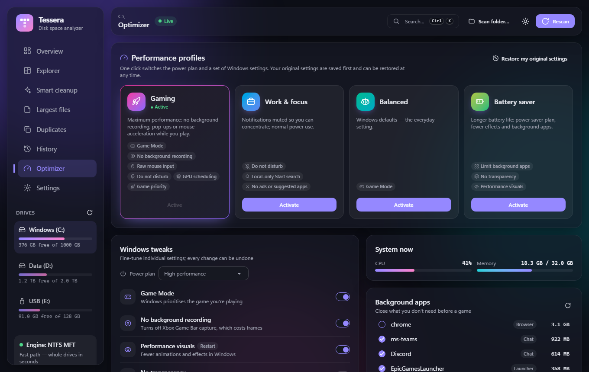
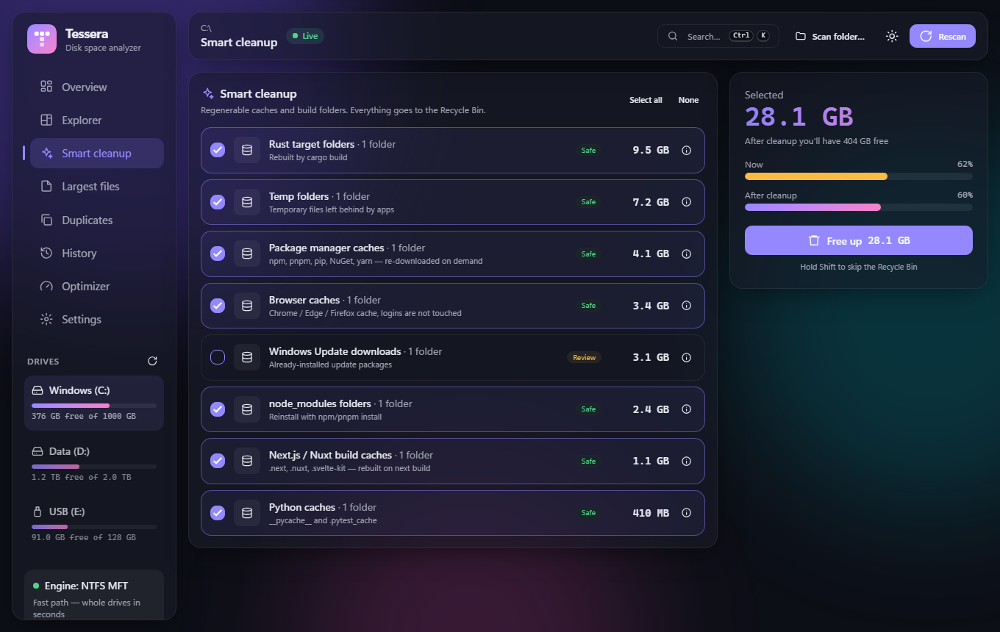
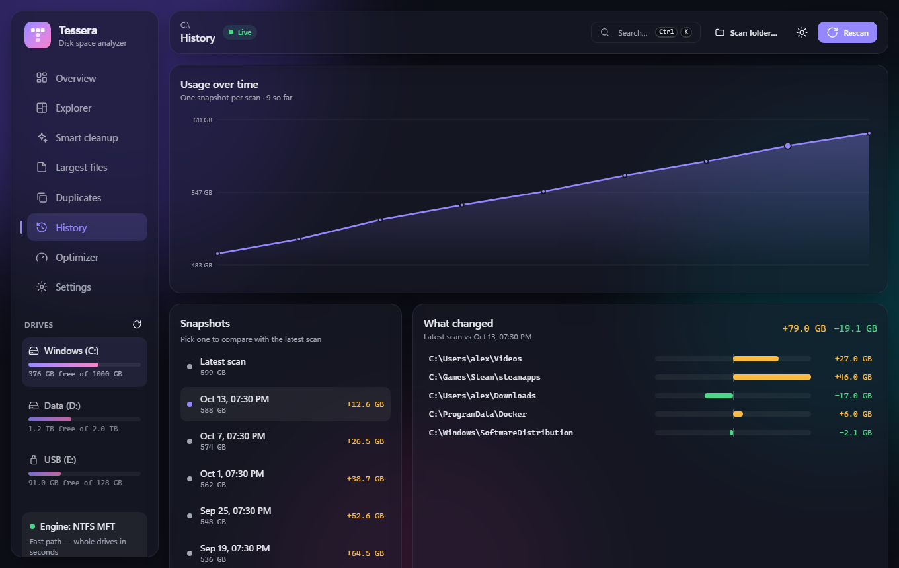
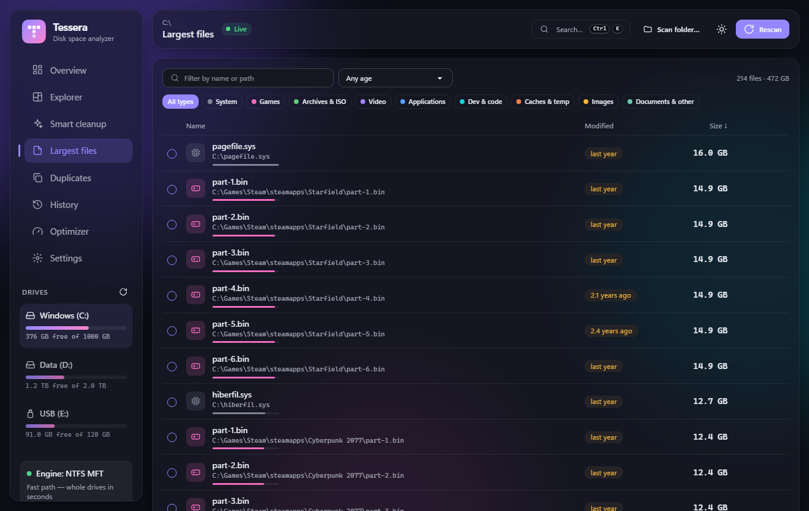
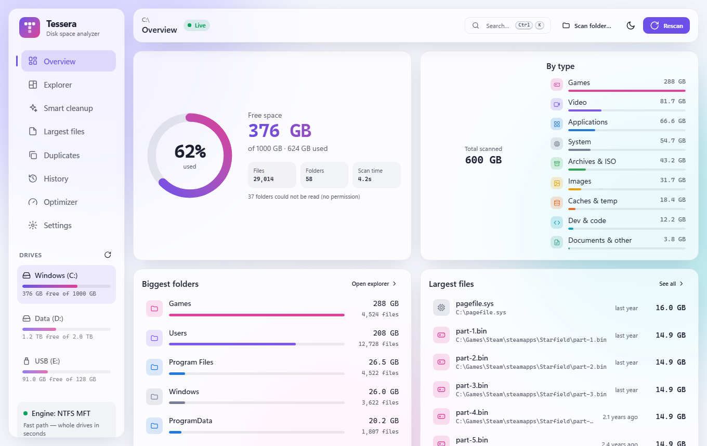

<div align="center">


# Tessera

**See what's eating your disk — fast, beautiful, cross-platform.**

A lightweight disk space analyzer for Windows, macOS and Linux with a parallel Rust scanner,
a zoomable treemap and smart cleanup that knows what's safe to delete — plus a one-click
Windows optimizer with gaming, work and battery profiles.

[](../../releases)
[](../../actions/workflows/ci.yml)
[](LICENSE)




</div>

---

## ✨ Features

|   |   |
|---|---|
| 🚀 **NTFS MFT fast path** | Run as administrator and Tessera reads the Master File Table straight from the volume — a whole drive in seconds, like WizTree. |
| ⚡ **Fast parallel scanner** | Without admin rights (or on other file systems) Rust + rayon walk every folder on all CPU cores. Junctions and symlinks are skipped so nothing is counted twice. |
| 👯 **Duplicate finder** | Size → quick head/tail hash → full **BLAKE3** confirmation. Keep newest, oldest or shortest path and remove the rest — or **replace them with hard links** so every path keeps working while the data is stored once. |
| 🔴 **Live changes** | After a scan Tessera watches the drive (ReadDirectoryChangesW / FSEvents / inotify) and re-reads only the folders that changed, so the numbers stay current without a rescan. |
| 💾 **Instant start** | Every scan is saved (compressed). Next launch opens it immediately and catches up on what changed while Tessera was closed — from the NTFS USN journal when running as admin, otherwise by checking folder timestamps. |
| 🎮 **Windows optimizer** | One-click **Gaming**, **Work & focus**, **Balanced** and **Battery saver** profiles: power plan, Game Mode, Game DVR, mouse acceleration, GPU scheduling, game priority, notifications, Start-menu ads and more. Startup-app manager and "close background apps before a game". Your original settings are backed up first and restored with one click; Defender, VBS, Windows Update and services are never touched. |
| 📈 **History & diffs** | Every scan saves a small snapshot. Chart usage over time and see exactly which folders grew or shrank. |
| ⌨️ **Command palette** | <kbd>Ctrl</kbd>+<kbd>K</kbd> to jump anywhere, rescan, switch drives or open a big file. |
| 🔄 **Auto-update** | Signed updates from GitHub Releases, downloaded in the background and installed when you restart. |
| 🧩 **Zoomable treemap** | Nested, cushion-shaded treemap on canvas, several levels deep — click any folder to zoom in with a smooth animation, Backspace to go up, right-click for actions. |
| 🍩 **Breakdown by type** | Video, games, dev, apps, system, images, caches, archives, documents — at a glance. |
| 🧹 **Smart cleanup** | Finds regenerable junk: `node_modules`, build caches (`.next`, `target`, `__pycache__`), package-manager caches, browser caches, temp folders. |
| 📄 **Largest files** | Sortable, filterable list with "not modified in 6 months" detection and bulk delete. |
| 🗑️ **Safe by default** | Everything goes to the Recycle Bin / Trash. Permanent delete is opt-in, needs confirmation, and system locations are always protected. |
| 🌍 **Multilingual** | English, Deutsch, Español, Français, Magyar, Polski — detected from your system, English fallback. |
| 🌗 **Light & dark** | Follows the system or pick your own. |
| 🪶 **Tiny** | ~5 MB app thanks to Tauri — uses the OS webview instead of bundling Chromium. |

## 📸 Screenshots

<table>
  <tr>
    <td></td>
    <td></td>
  </tr>
  <tr>
    <td align="center"><b>Explorer</b> — nested, zoomable treemap</td>
    <td align="center"><b>Optimizer</b> — gaming, work and battery profiles</td>
  </tr>
  <tr>
    <td></td>
    <td></td>
  </tr>
  <tr>
    <td align="center"><b>Smart cleanup</b> — reclaim space safely</td>
    <td align="center"><b>History</b> — usage over time and what changed</td>
  </tr>
  <tr>
    <td></td>
    <td></td>
  </tr>
  <tr>
    <td align="center"><b>Largest files</b> — filter, sort, bulk delete</td>
    <td align="center"><b>Light theme</b> — or follow the system</td>
  </tr>
</table>

> Screenshots are taken from the real app running on sample data (`pnpm dev` in a browser uses a built-in
> mock backend, so nothing from a real disk is shown).

## 📥 Download

Grab the latest installer from **[Releases](../../releases)**:

| Platform | File |
|---|---|
| Windows 10/11 | `Tessera_x.y.z_x64-setup.exe` (or `.msi`) |
| macOS 11+ (Intel & Apple Silicon) | `Tessera_x.y.z_universal.dmg` |
| Linux | `.AppImage`, `.deb` or `.rpm` |

The Windows setup lets you install **for the current user** (no admin) **or for all users**, in English,
Deutsch, Español, Français, Magyar or Polski. It creates a Start menu entry, registers Tessera in **Settings › Apps** (Add/Remove
Programs) and ships a proper uninstaller. Prefer group-policy deployment? Use the `.msi`.

> **Tip:** On Windows, folders like `C:\Windows\System32\config` need administrator rights to read.
> Tessera skips them and shows how many folders it couldn't access.

## 🛠️ Building locally

**Requirements:** [Rust](https://rustup.rs) (stable), [Node.js](https://nodejs.org) 22+, [pnpm](https://pnpm.io) 10+,
and the [Tauri prerequisites](https://v2.tauri.app/start/prerequisites/) for your OS
(on Windows: Microsoft C++ Build Tools + WebView2, which Windows 11 already has).

```powershell
# Windows
./scripts/build.ps1            # installers → src-tauri/target/release/bundle/
./scripts/build.ps1 -Dev       # dev mode with hot reload
./scripts/build.ps1 -Portable  # also copies a portable .exe to dist/
```

```bash
# macOS / Linux
./scripts/build.sh             # bundles → src-tauri/target/release/bundle/
./scripts/build.sh --dev       # dev mode with hot reload
```

Or directly: `pnpm install` then `pnpm tauri dev` / `pnpm tauri build`.

**UI only:** `pnpm dev` and open http://localhost:1420 in a browser. Without the Tauri runtime the app
switches to a mock backend with sample data, so you can work on the interface without Rust. Add
`?view=explorer&theme=light&lang=de` to jump straight to a view, theme and language.

## 🧱 Tech stack

```
src-tauri/   Rust core — scanner + MFT reader, size tree, scan cache, live watcher, duplicates,
             optimizer (Windows), delete/trash, Tauri commands
src/         Svelte 5 + Tailwind 4 + daisyUI 5 — views, canvas treemap, i18n, dev mock backend
design/      HTML mockup and logo explorations
```

- **Shell:** [Tauri 2](https://tauri.app) · **Core:** Rust, rayon, sysinfo, trash
- **UI:** Svelte 5 (runes), SvelteKit static adapter, Tailwind CSS 4, daisyUI 5
- The scan tree lives in Rust; the UI asks for one level at a time, so even million-file drives stay responsive.

## 🌍 Translations

Strings live in [`src/lib/locales/`](src/lib/locales). To add a language, copy `en.json` to `<code>.json`,
translate the values and register it in [`src/lib/i18n.svelte.ts`](src/lib/i18n.svelte.ts). Missing keys fall back to English.

## 🚀 Releases

Releases are cut in two steps, so GitHub Actions minutes are only spent once Windows is known to be good:

1. **Windows, locally.** On an up-to-date, clean `main`, run

   ```powershell
   ./scripts/release.ps1             # -DryRun to only build, -WindowsOnly to stop after step 1
   ```

   It builds the signed installers, writes `latest.json`, tags `vX.Y.Z` and publishes the GitHub Release.
2. **macOS + Linux, on Actions.** Only if step 1 succeeded, the script starts
   [the release workflow](.github/workflows/release.yml), which first checks that the release really has the
   Windows installer, signature and `latest.json`, then adds the universal macOS `.dmg` and the Linux
   `.AppImage` / `.deb` / `.rpm` and merges their entries into `latest.json`.
   To rerun it by hand: `gh workflow run release.yml -f tag=vX.Y.Z`.

Bump the version in `package.json`, `src-tauri/Cargo.toml` and `src-tauri/tauri.conf.json` before releasing.

**Auto-update signing.** Updates are verified with a minisign key; the public half is in
`src-tauri/tauri.conf.json`. Maintainers keep the private key in `~/.tauri/tessera.key` (local builds pick it up
automatically) and in the repository secrets `TAURI_SIGNING_PRIVATE_KEY` / `TAURI_SIGNING_PRIVATE_KEY_PASSWORD`
for CI. Contributors without the key still get a working build — just without update artifacts.

## 🗺️ Roadmap

- [x] NTFS MFT fast path on Windows (needs admin)
- [x] Duplicate finder (size → partial hash → BLAKE3)
- [x] Usage history & snapshot diffs
- [x] Auto-update from GitHub Releases (signed, via `tauri-plugin-updater`)
- [x] Command palette (Ctrl+K)
- [x] Watch for live changes (ReadDirectoryChangesW / FSEvents / inotify)
- [x] Hardlink-based dedupe instead of deleting
- [x] More languages: Español, Français, Polski
- [x] Saved scans that open instantly and catch up via the NTFS USN journal
- [x] Windows optimizer with switchable profiles
- [ ] Per-game profiles that switch automatically when a game starts
- [ ] Even more languages — [help translate!](CONTRIBUTING.md#translations)

## 🤝 Contributing

**Feel free to contribute!** Bug reports, ideas, translations, new cleanup rules, design feedback and code are all
welcome — no contribution is too small. Good places to start:

- 🌍 add or polish a [translation](src/lib/locales)
- 🧹 teach Smart cleanup a new safe-to-delete cache
- 🐛 pick an issue labelled **`good first issue`**

Read **[CONTRIBUTING.md](CONTRIBUTING.md)** for setup and guidelines. `main` is protected: changes land through
pull requests that pass CI and are approved by a code owner.

## 📄 License

[MIT](LICENSE) © Tessera contributors
